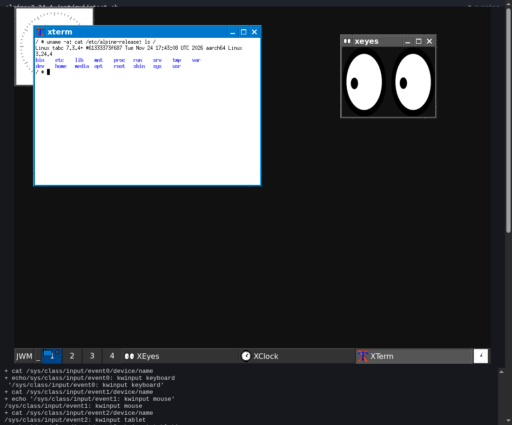

# A Linux desktop in a tab: Xorg on unkernel, x86-64 programs lifted or emulated at once

[tabc-pisco.md](tabc-pisco.md) runs amd64 containers in a browser tab: tabc's guest kernel (unkernel, Linux built
for wasm) with PISCO in it, their programs lifted ahead of time. This page gives that guest a screen, a keyboard
and a mouse and runs a desktop on them; then makes any x86-64 program start at once, lifted or not; then looks at
what makes it slow.

## Short answer

- **A desktop in a tab.** Xorg (Alpine's `xorg-server`, the `fbdev` driver, `evdev` input) on unkernel's
  framebuffer, JWM as the window manager, xterm, xeyes and xclock, in headless Chrome: the page shows the picture
  and sends the keys and the pointer. Typed into xterm, `uname -a` answers from the guest; a click on JWM's button
  opens its menu; the eyes follow the pointer. About 300 lines in tabc's page and supervisor
  ([How](#1-a-desktop-in-a-tab)).
  
- **Any x86-64 program, at once: a first tier.** A program PISCO has not lifted yet no longer waits for its lift
  (seconds for a small program, minutes for a large library): the task is started again on qemu-user, in the same
  guest, and the host lifts it meanwhile; the next run is lifted
  ([How](#2-any-program-at-once-a-first-tier)). Cold, `sh -c 'echo; md5sum'` in an amd64 image with nothing lifted
  takes 4 s on qemu-user; once lifted, 1.8 s.
- **A library lifted once, for every program.** A library's image (what is lifted, keyed by its sha256) depended
  on where the loader mapped it and on what other modules its relocations pointed at, so the same library was
  lifted again for each program that mapped it elsewhere: 23 of the 52 images an x86-64 desktop met were such
  repeats. Each library now gets an address of its own (from its path), and its image is made the same in every
  program; RESULT_CANON.
- **Fast.** RESULT_FAST

## 1. A desktop in a tab

unkernel's kernel has a framebuffer driver (kwfb, `/dev/fb0`, XRGB8888 in the guest's memory) and an input driver
(kwinput: an evdev keyboard, mouse and tablet), offered when the kernel is created with `display`. tabc does not use
them. The patch (`tools/tabc-pisco/tabc.patch`):

- **The supervisor**: `TABC_DISPLAY=WIDTHxHEIGHT` puts a `display` in the page's configuration.
- **The worker** (`page/guest.js`, where the kernel runs): `createKernel({display})`; every 33 ms, between the
  kernel's slices, the rows of the framebuffer that changed since the last look are copied and posted to the page,
  as XRGB. The SDK's `frame()` copies the whole picture as RGBA, on the kernel's thread, each time; the display's
  `pixels()` is the framebuffer in place, reached by wrapping `DisplayHost`'s methods (the SDK exports the class).
  The page's keys, pointer, buttons and wheel go to the guest's evdev devices (`domCodeToLinux`,
  `domButtonToLinux`).
- **The page** (`page/main.js`): a canvas above the terminal; the rows to RGBA and `putImageData`, on the page's
  thread; pointer and key events over the canvas to the worker. `tabcInput()` sends the same messages, for a test.

In the guest (`docs/research/linux-gui/start.sh`): `apk add xorg-server xf86-video-fbdev xf86-input-evdev jwm xterm
font-misc-misc font-cursor-misc font-dejavu xeyes xclock`, an `xorg.conf` with the fbdev device and the three evdev
devices, then `Xorg :0 vt7 -sharevts -novtswitch`, JWM and the apps. The kernel has no virtual consoles
(`CONFIG_VT` is off): Xorg is given `/dev/console` as its console and never switches it. On arm64 (kwemu), the
install takes 42 s (the packages from a cache) and Xorg is up in 1 s.

## 2. Any program, at once: a first tier

PISCO lifts a program the first time it runs, on the host, before it goes on: busybox 55 s, libcrypto 7.5 min.
That is the wait a person sees the first time anything new runs. The first tier removes it:

- **Who may go to the first tier.** x86load, which turns an exec of an x86-64 file into an x86-64 task, marks the
  task clean and keeps its first stack (argc, argv, environment, auxv). The task stays clean while it only does
  what a second start would do again: mmap, open and read files (not standard input), fstat, mprotect, brk,
  sigaction, the TTY queries a loader makes (`harmless()` in `runtime.c`). Anything else (a write, a fork, an
  ioctl that changes something) makes it dirty.
- **What happens on a miss.** Code that no lifted program holds is met: the runtime asks the page for the image
  without waiting. The page asks the supervisor (a second, so that one lifted for an earlier container comes back
  at once), and otherwise has it lifted in the background and answers "later". A clean task is then made to
  `execve("/.pisco/qemu-x86_64", ["qemu-x86_64", "-0", argv0, path, args...], envp)` from where it is: the same
  program, arguments and environment, on qemu-user (an aarch64 program under kwemu). A dirty task waits for the
  lift, as before, and its lift goes ahead of the background ones.
- **What else is lifted.** At that moment musl's loader has usually mapped every library the program needs:
  `r_debug`'s `link_map` (through the program's `DT_DEBUG`) names them, and they are lifted in the background too.
  The next run finds them lifted.
- **Lifts outlive the container.** The supervisor runs `lift-side.sh` in a session of its own, into a temporary
  file renamed when done, with a lock file beside it: a lift started for a container that has exited is there
  for the next one.
- **The tier, in the guest.** tabc's init bind-mounts `/tabc/bin` (x86load and qemu-x86_64) at `/.pisco` in the
  container's root. qemu-x86_64 is Alpine's (static, aarch64); `setup.sh` fetches it.

RESULT_TIER

## 3. One library, one lift

TEXT_CANON

## 4. Fast

TEXT_FAST

## Limits

- qemu-user under kwemu is slow for heavy programs: the first `update-mime-database` of an x86-64 Xorg install
  took 10 min there. The first tier trades the wait for a lift against a slow first run; for a long-running
  program the wait is the better trade, and nothing chooses between them yet.
- A program loaded with `dlopen` after it has done work (Xorg's modules) waits for its lift: its task is dirty.
- PISCO needs the one-CPU kernel; the desktop runs on one CPU.
- A lock file left by a lift that was killed stops that program's lifts until it is removed.
- The display is the framebuffer: no GPU. unkernel also has virtio-gpu (virgl on WebGL2) and a Vulkan driver on
  WebGPU, not tried here.

## Reproduce

```sh
tools/tabc-pisco/setup.sh   # tabc with the patch, the kernel, PISCO's runtime, qemu-x86_64
O=out/tabc-pisco
# arm64 (kwemu): the desktop
TABC_DISPLAY=1024x768 TABC_CHROMIUM_FLAGS="--remote-debugging-port=9333 --window-size=1100,1000" \
  TABC_CHROMIUM=$(command -v google-chrome) TABC_SHARE=$O/share \
  $O/tabc run -m 2048m -v $PWD/docs/research/linux-gui:/opt/gui alpine:3.24.4 /opt/gui/start.sh
# amd64 (PISCO, the first tier): the same, with
#   TABC_IMAGE_ARCH=amd64 TABC_PISCO_LIFT=$PWD/tools/tabc-pisco/lift-side.sh
node docs/research/linux-gui/shot.mjs 9333 shot.png   # a screenshot of the tab
```
